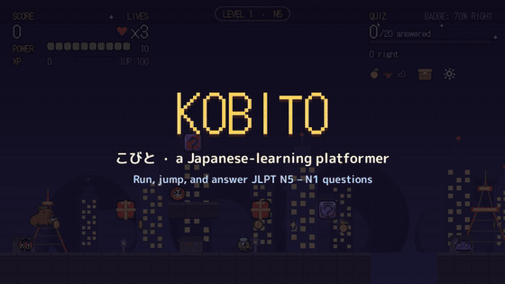

# Kobito

An 8-bit style Japanese-learning platformer built with Pygame.



*The game playing itself ([MP4, 50 s](docs/cover.mp4)). Re-record it with
`python tools/record_cover.py` (needs ffmpeg): it runs the real game
headless with a scripted player and writes `docs/cover.mp4` and
`docs/cover.gif`.*

**30-second ad:** [16:9 for YouTube / web](docs/ad_16x9.mp4) ·
[9:16 for TikTok, Reels, Shorts](docs/ad_9x16.mp4). It opens on a hook
("Can a video game teach you Japanese?"), then runs three chapters: how
to play, what you learn and your AI companion. It's cut from the real game
with a chiptune soundtrack synthesised in code; re-make it with
`python tools/make_ad.py` (needs ffmpeg and numpy).

## Setup

```
pip install -r requirements.txt
python main.py
```

To let Kobito (see below) write real AI hints instead of using its
built-in hints, set **any one** of these API keys before running — Claude,
Gemini or ChatGPT (no extra install: it's plain HTTPS):

```
export ANTHROPIC_API_KEY=your-key-here     # Claude
export GEMINI_API_KEY=your-key-here        # Google Gemini
export OPENAI_API_KEY=your-key-here        # ChatGPT
```

With more than one set, it tries Claude, then Gemini, then ChatGPT (or the
one named in `KOBITO_AI_PROVIDER=gemini`), and moves to the next if one is
down. The game works fine without any — hints then come from the built-in
per-question hints. To give **everyone** AI hints (the web build too)
without sharing a key, run the AI proxy: see
[AI hints for everyone](#ai-hints-for-everyone-the-ai-proxy).

## Controls

- **Left/Right arrows or A/D** — choose mascot/companion/world/difficulty (select screens) / run (in-level)
- **Space / W / Up** — jump; **Enter/Space** — confirm a selection
- **Shift / X / J** — hold to **run**; with sun power, press (or **F**) to **throw a sunball**
- **Jump again in mid-air** — flap upward (twice per jump); **hold jump while falling** — glide
- **Jump at a wall and hold toward it** — climb it; **jump while on the wall** — wall jump
- **Up/Down + Enter (or Space)** — move the highlight through a quiz's
  choices and answer with it; **1-4** still picks a choice directly, and
  the mouse can hover/click a choice
- **S** — skip (pass on) the question instead of answering it
- **Enter/Space** — dismiss Kobito's hint after a wrong answer, or continue after completing a level
- **Esc / P** — pause and open **Settings** (save, lesson log, item box, music, sound effects, furigana,
  translation, save & quit); **L** in the pause menu opens the **lesson log** straight away
- With the **propeller cap** on: **hold jump in mid-air** to fly up
- **F11** (or **Alt+Enter**, or Settings → Full screen) — full screen on/off

**Window size:** the game draws a 960×540 picture and shows it scaled up
(`kobito/display.py`): the window opens at about 85% of your screen —
an exact 2× or 3× when that fits, so pixels stay even — and you can drag
its edge to resize it (the picture keeps its shape). Full screen is
remembered for next time.

A gamepad works everywhere alongside the keyboard — plug one in before or
during play, it's picked up automatically (hot-plug supported):

- **D-pad / left stick** — move / navigate menus
- **A** — jump; confirm a selection; continue after Kobito's hint or a level
- **B** — back (in Settings), undo a tile (Stage Test), skip the review
- **Start / Back** — open Settings; **Y** there opens the lesson log
- **D-pad / stick up-down + A** — choose and answer in a quiz
- **B / X** — hold to run; with sun power, press to throw a sunball
- **LB / RB / Start** — skip the question

Buttons are read by **name, not number** (`kobito/input.py`): each pad's own
numbering is translated to the Xbox layout above, so A is always the bottom
face button. Recognised layouts:

| Controller | Notes |
| --- | --- |
| **Logitech F310** (also F510 / F710), switch on **X** | XInput — the default. Works on Windows and Linux. |
| **Logitech F310** (also F510 / F710), switch on **D** | DirectInput ("Logitech Dual Action") — detected by name or USB id and remapped (its buttons come as X=0, A=1, B=2, … Start=9). Use this mode on macOS, which doesn't support XInput pads natively. Keep the **MODE** light off, or the d-pad and left stick swap. |
| Xbox / XInput pads | Native layout. |
| Any pad in the **web build** | The browser's standard layout; its d-pad (buttons 12–15) is turned into d-pad movement. |

**Controller not responding?** Run `python tools/pad_test.py`: it lists the
controllers your computer sees (and the layout the game will use), then
shows each button as the game reads it. On a Mac, a Logitech F310 must be
on **D** — in X mode macOS doesn't see it at all.

On the web build (see below), on-screen touch buttons appear automatically
instead — a left/right/jump trio during gameplay, and prev/next/OK
arrows on every menu and quiz screen — since a phone has neither a
keyboard nor a gamepad. They're built entirely from the same input
handling as keyboard/joystick (see `kobito/input.py`); nothing about the
desktop build changes.

## Playing on the web or a phone

The exact same codebase also builds into a static, no-install web
version via [Pygbag](https://github.com/pygame-web/pygbag) (Python and
Pygame compiled to WebAssembly), playable in a desktop or mobile browser
with the on-screen touch controls above.

### Share a link (GitHub Pages — automatic)

`.github/workflows/web.yml` builds the web version on every push and
publishes it with **GitHub Pages**, so the game lives at

    https://bonimit.github.io/kobito/

One-time setup: on GitHub open the repository's **Settings → Pages** and
set **Source** to **GitHub Actions**. Then push (or run the "Web build"
workflow from the Actions tab); a couple of minutes later the link works,
and every later push updates it. GitHub Pages is free for **public**
repositories; a private repository needs a paid GitHub plan for it (and
the published game is public either way) — otherwise use itch.io or
Vercel below, which work from a private repository. Send that link to anyone — it plays in
Chrome, Safari, Edge and Firefox, on computers, tablets and phones.

### Other places to put it

- **itch.io** (a game site with a nice page, comments and a full-screen
  button; works from a private repository):
  1. On itch.io: **Upload new project** — title *Kobito*, **Kind of
     project: HTML**. Upload the **kobito-web** zip from the latest "Web
     build" run (Actions tab → the run → *Artifacts*) and tick **This file
     will be played in the browser**. Under *Embed options* set the
     viewport to **960 × 540**, turn on **Fullscreen button** and
     **Mobile friendly**, then choose who can see it (*Public*, or
     *Restricted* with a password) and **Save**. The page's link (e.g.
     `https://bonimit.itch.io/kobito`) is the one to share.
  2. To update it automatically on every push: itch.io → *Settings → API
     keys* → **Generate new API key**; then on GitHub → *Settings →
     Secrets and variables → Actions* add a **secret** `BUTLER_API_KEY`
     (that key) and a **variable** `ITCH_GAME` (`your-itch-name/kobito`).
     The workflow's *itch* job then uploads each new build with butler,
     itch.io's upload tool — no more manual zips.
- **Vercel / Netlify / any static host**: `vercel.json` makes a
  git-connected Vercel project run the same build; or build it yourself
  and upload `build/web/`:

```
pip install pygbag
./packaging/build_web.sh                       # leaves the site in build/web/
python -m http.server -d build/web 8000        # try it at http://localhost:8000
```

The build only packs `main.py`, `kobito/` and `assets/` (about 21 MB,
mostly the Japanese fonts) — not the docs' videos or the tools.

A few things behave differently in the web build:
- **AI hints** can't use an API key in the browser (a key in a web page is
  public), so by default the web build uses the built-in hints. Point it at
  your **AI proxy** (below) and it gets live Claude / Gemini / ChatGPT hints
  too: set the repository variable `AI_PROXY_URL`.
- **Saves, players and trophies** live in that browser (localStorage) —
  each person's progress stays on their own device. The **leaderboard**
  shows the players of that browser; the world leaderboard server is a
  desktop-game feature.
- The first load is slower than a native launch (the browser is
  downloading a WASM Python runtime and the game), but it's cached after
  that. Browsers only allow sound after the first click or key press.

## Standalone desktop builds

For a single executable that runs without installing Python or any
dependency (share it, or just avoid re-running `pip install` yourself):

```
pip install pyinstaller
python packaging/build_desktop.py
```

This produces `dist/Kobito` (`dist/Kobito.exe` on Windows). PyInstaller
bundles for whatever OS it runs *on* — it doesn't cross-compile — so
build a Windows .exe on Windows, a macOS .app on a Mac, and a Linux
binary on Linux; there's no way to produce all three from one machine.
AI hints work in the packaged app the same way: set an API key (or
`KOBITO_AI_URL`) in the environment before launching it.

## Question blocks

**How they look.** Quiz blocks are chunky bevelled blocks with a dark
outline, a soft pulsing glow behind them and a shine that sweeps across every
few seconds, in a colour picked per world to stand out from its scenery
(gold in the forest, turquoise in the desert, coral underwater, jade in
Korea, …). Their faces vary through a level: a classic **?**, a **?**
medallion with stars, or **問** (*mon*, "question"). Answered blocks turn to
grey stone with a green **✓** if you got it right or a red **✗** if you got
it wrong (kept when you save and continue); skipped ones stay "?" boxes
(`kobito/entities/question_block.py`). The quiz
card that pops up is nearly solid, with a coloured header band and border per
question type — **vocabulary** blue, **kanji** vermilion, **grammar** green,
**verbs** purple, **expressions** gold, **loanwords** teal, **reading** pink —
and the choice highlight takes the same colour.

Yellow "?" blocks (drawn slightly larger than a tile, Mario-block style)
pause gameplay and show a small black box — anchored right next to the
block, above it if there's room or below otherwise, rest of the level
still visible, with a tooltip-style tail that touches the block itself
(no floating gap) so the box clearly reads as popping up *from* it —
with a multiple-choice Japanese question at the level's current JLPT
level (see Difficulty below), from a bank of **1,408 questions**:

| JLPT | N5 | N4 | N3 | N2 | N1 |
| --- | --- | --- | --- | --- | --- |
| Questions | 386 | 357 | 304 | 191 | 170 |

280 are hand-written (`assets/data/questions.json`, 56 per level). The
rest are generated (`kobito/question_gen.py`) from word and verb lists for
each level (`kobito/word_data.py`): for every word, "What does 天気
(tenki) mean?", "Which word means 'weather'?" and, for kanji words, "How
do you read 天気?"; for every verb, its forms for that level (te-form,
nai-form, potential, passive, …) conjugated by rule
(`kobito/conjugation.py`). Wrong choices are other words of the same kind
and level, near-miss readings (a dropped long vowel, a missing ゛, a stray
っ) and the classic conjugation slips (書きて, 帰ます). The bank is built
the same way every time, so saves can refer to any question. A stage asks
30, so you can replay many stages before anything repeats: 10 N5 stages
in a row (300 questions) without a single repeat, 5 at N1.

There are seven kinds:

- **Vocabulary** — what does 犬 (inu) mean?
- **Kanji** — how do you read 日本語?
- **Grammar** — which particle or pattern fills the gap?
- **Verbs** — conjugate 食べる into the polite past, and so on.
- **Expressions** — what do you say when you leave the office first, enter
  a friend's home or meet someone new? At N2/N1: idioms (猫の手も借りたい,
  顔が広い) and four-character sayings (一石二鳥, 十人十色).
- **Loanwords** — katakana words: コンビニ, アルバイト, and false friends like
  マンション (an apartment, not a mansion).
- **Reading** — a short sentence or two, then a question about it (who is
  taller? when is the deadline? what does the sign forbid?).

**Variety.** Questions come in a random order, and so do the four answers.
The next question is never the same kind as either of the last two (no
three kanji questions in a row). The run also remembers which questions
you've already met (saved with your game), so each new level asks ones
you haven't seen yet before repeating any — and when it has to repeat, it
picks the ones you saw longest ago. AI Adaptive mode follows the same
variety rule while it picks questions at the right difficulty.

Question blocks are kept well apart — **at least 8 tiles between any two**
(`MIN_QUESTION_SPACING_TILES` in `kobito/levels/level1.py`) — and levels
are long (about 400 tiles), so there are real stretches of running,
jumping, stomping and snack-hunting between quizzes, not a quiz every few
steps.

A question's worth scales with its level, shown up front in the quiz box
as e.g. `N3 · GRAMMAR · 20 XP`:

| Level | Correct | Wrong |
| --- | --- | --- |
| N5 | +10 | −4 XP |
| N4 | +15 | −6 XP |
| N3 | +20 | −8 XP |
| N2 | +30 | −11 XP |
| N1 | +40 | −15 XP |

Correct answers add to your **XP** as well as the score. XP is a plain
running total ("XP 1269"), not a bar that refills — it keeps counting up
across levels, and every 100 XP earns a bonus life (the HUD shows how far
you are from the next 1UP). Wrong answers and enemy hits take a little XP
off. Each block only
fires once. Add more questions by appending objects to that JSON file — each needs `category`,
`jlpt` (`N5`-`N1`), `prompt`, a `choices` list, an `answer` index, an
`explanation`, and a `hint` — a nudge pointing at the useful clue (a
radical, a particle's role, a stem change) without giving the answer
away. Both feed Kobito's hint below.

### Saving

Your run is saved automatically, and you can save any time yourself:

- **Stage clear** — autosaves a checkpoint at the start of the next level.
- **Settings → Save game** — saves your *exact spot*: where you're standing,
  power, lives, quiz progress, and which question boxes, gift boxes, coins
  and enemies are already gone.
- **Settings → Save & quit**, or just closing the window mid-level — the same.
- Your **item box**, **badges**, score and XP are part of the save, and the
  furigana / translation / music / sound-effect toggles are remembered
  between sessions.
- Your **ability level, 円 and wardrobe** (see *Ability level, costumes and
  Kobito Town*) are kept separately: they carry over even when you start a
  New Game.

Saves are per player (see *Who's playing?* below). When a save exists the game opens on a title screen showing it (mascot,
companion, level, world, score, your Lv, badges, items) with **Continue**,
**New Game** or **Town** (visit your house and the konbini first) — New Game
asks once more before replacing the save. Running out of
lives leaves the save as it was, so Continue picks up from your last save.

Where it's stored (`kobito/save_game.py`): `%APPDATA%\Kobito\save.json` on
Windows, `~/Library/Application Support/Kobito/save.json` on macOS,
`~/.local/share/kobito/save.json` on Linux (override with `KOBITO_SAVE_PATH`),
and the browser's localStorage in the web build. Delete the file to start
completely fresh; a damaged or outdated save is simply ignored.

### HUD, settings and the item box

The HUD is plain outlined text and icons in the top corners — no backing
cards, so it covers as little of the world as possible — each read top-down as label →
big number → detail: the left one is you (score, lives, the 10-pip power
gauge, XP toward the next 1UP, and your ability **LV** with its study-EXP bar
and your 円), the right one is the lesson (questions
answered toward the badge, how many right, your accuracy). Temporary states
(sleepy, boost) pop up as a tag under the left card. Under the quiz card is
a small tray: your mascot's favourite foods, the **item box** (a crate with
a count) and a **gear**.

The item box keeps every item you've picked up this run, across levels.
The HUD only shows the crate; click/tap it (or open Settings → Item Box) to
see each item with its Japanese word, reading and how many you've found.

Settings (`kobito/settings_screen.py`) pauses the level: Resume, Save game,
Lesson log, Item Box, Music ON/OFF, Sound effects ON/OFF, Furigana ON/OFF,
Translation ON/OFF, Save & quit. It works with arrow keys + Enter, the mouse,
touch and a gamepad (d-pad, A, B).

**Lesson log** — one press of **L** (gamepad **Y**) in the pause menu, or
its row, shows every question asked so far this stage: ✓ / ✗ / — (skipped),
your answer, the right one and why, plus the words you've met (items, secret
places). It's the same card layout as the end-of-stage review, read-only;
Enter / Esc / L goes back to the menu.

The companion's box (item comments and lessons) sits in the **bottom-left
corner**, in the strip under the ground line, so it never covers your
character; larger rounded type with a name plate, and a pickup's vocabulary
lesson is its second page. When a question opens, the quiz's own companion
box takes over.

Fonts (all bundled under `assets/fonts/`, see the licence files there):
**DotGothic16** for the pixel HUD labels, numbers and titles, **M PLUS
Rounded 1c** for sentences (the companion, menus), and **IPA Gothic** for
quiz text, which needs full kanji coverage. The shared panel/text/icon
helpers live in `kobito/ui.py`.

Japanese text renders with a bundled font (`assets/fonts/ipag.ttf`,
IPA Font License v1.0) since pygame's default font has no CJK glyphs.

### Furigana and translation

Two independent toggles, both in **Settings** (Esc / P / Start, or the
gear icon in the HUD). While a question is open, **F** and **T** still work
as shortcuts:

- **F** — furigana: small kana readings above kanji (`kobito/furigana.py`),
  on by default. Toggling it off drops back to plain kanji.
- **T** — translation: the English translation of the prompt, hidden by
  default so it can't hand you a grammar answer for free (a sentence
  like "...at the library" gives away that the blank wants a location
  particle). Off by default; press T to reveal it inline, right below
  the Japanese line.

Furigana is looked up from a hand-built reading dictionary covering
every kanji that appears in the question bank in the way it's actually
used there (not a general-purpose kanji dictionary) — a handful of
genuinely ambiguous readings (bare "一", "物", and the irregular verb
"来る", whose reading changes per conjugation: 来い is こい but 来れば
is くれば) are deliberately left unannotated rather than guessed wrong.
**Kanji-category questions never show furigana**, regardless of the
toggle — the question is literally "how do you read this kanji," so
annotating it would hand over the answer.

### Read more

If the question or the companion's hint isn't enough, press **R** once
an answer is locked in (right or wrong) to slide in a detail panel from
the right edge of the screen: the full question, the correct choice
spelled out, the complete explanation, and the authored hint, all in
one place. It's only available after answering, so it can never spoil
the question, and a small "R · Read more" tab stays visible the whole
time so it's discoverable without reading this README.

Wherever a Japanese sentence is followed by its English translation in
parentheses (e.g. `図書館で本を読みます。 (I read books at the
library.)`), the panel splits them onto separate lines instead of
letting them run together as one wrapped paragraph -- a short reading
gloss stuck mid-sentence right after a word (`犬 (inu) means...`) is
left alone, since that's a reading, not a translation.

## Your AI hint companion

Your companion **talks like itself and doesn't repeat**: each one has its
own lines for while you think ("I'm rooting for you! Get it? Roots?" —
Kinoko), for a right answer ("Mooo-velous!" — Ushi) and for a miss, and
never says the same line twice in a row. When it speaks up after ~10
seconds, it goes straight to the point with a **TIP** — no "Hmm, a tricky
one…" — and Claude is told to skip filler openers too. The generated
questions' hints are specific to the question: which trap to watch for
("Check the dakuten: is it と or ど?", "Is there a small っ?"), the first
sound of the word you want, or the kanji to focus on.

**After a wrong answer** the companion's bar grows into a **hint panel**,
typed out line by line: its own reaction ("Ooh, so close!" for Hana,
"Mushroom for improvement!" for Kinoko), the **✓ answer**, a **TIP** —
the AI's hint for that exact question with an API key or proxy, otherwise the
question's own — and, with Ume-shu (Deep Insight), **WHY**: the full
explanation. The question box stays put above it, and **Read more** (R, or
Y on a gamepad) sits in the box's bottom row for the full write-up.

**Furigana** (on/off in Settings, or F during a question) covers every
kanji in every question and answer — readings come from the game's own
data (each word's and verb's kana, every conjugated form, item and place
names, and readings written into the questions like 「日本語 (にほんご)」),
split over each word's kanji automatically (締め切り → 締し め 切き り). It
applies everywhere in the quiz: the question box, your companion's bar and
the hint panel. Kanji-reading questions never show it, since the reading
is the answer.

The question box itself wraps everything to fit — Japanese is broken
between characters where Japanese allows it (never before 、。」 or small
kana, never inside a kanji word), long answers wrap under their number, and
reading questions get a wider box with the passage in its own quote block.

While a question is open, your companion's dialogue box is a **slim,
full-width bar docked in the strip under the ground line** — always the same
place, never covering the level or your character (while you answer or right
after), and nothing overlaps it; the question box
always stays clear of it. If you've been **thinking about a question for
about 10 seconds** without answering (moving between choices doesn't
reset this), the companion **speaks up**: its box flashes gold, a "!" pops
over its portrait, and it offers a hint — a nudge toward the clue, never the
answer. With an AI set up (Claude, Gemini or ChatGPT), it writes that hint for the exact question in
your companion's voice; it's requested in the background a few seconds
early so it's ready on time, and the question's own authored hint shows
instantly whenever the AI isn't available (offline, no key, slow network).

### Setting up a new game

A new game takes four steps, shown in a step bar at the top of each
screen — **HERO › COMPANION › WORLD › LEVEL** — over a slowly scrolling
night-time Tokyo (`kobito/setup_ui.py`):

- **Choose your hero** (`kobito/select_screen.py`) — the highlighted
  mascot stands big on a lit stage (hopping now and then), next to a card
  with its name in Japanese (カピバラ, きつね, …), a line about it and its
  two **favourite snacks** with their Japanese names — the items that earn
  bonus points when you find them in a level.
- **Choose your AI companion** (`kobito/companion_select_screen.py`) —
  the companion floats on the stage and greets you in its own voice in a
  speech bubble. Its card shows its name, personality and **ability**,
  what every companion does for you (explains wrong answers, nudges you
  when you're stuck ~10 s, teaches the word for each item you collect) and
  whether hints are **LIVE AI HINTS · CLAUDE / GEMINI / CHATGPT** (an API key
  is set up), **LIVE AI HINTS · ONLINE** (through an AI proxy) or
  **BUILT-IN HINTS**.

Both have a roster strip of every choice along the bottom: browse with
←/→ (or A/D, d-pad, stick, or the ◀ ▶ buttons), click or tap a card to
look at it, then click it again, press Enter / Space / A, or hit
**CHOOSE**.

- **Choose your world on the map** (`kobito/world_select_screen.py`,
  `kobito/world_map.py`) — an RPG-style **overworld**. Your mascot, in
  whatever it's wearing, walks around a big map with the **arrow keys /
  WASD / d-pad / stick** (or tap a town and it walks there along the roads).
  The 23 worlds are towns on one continent and its islands, each with its
  own patch of country and a landmark — Mt Fuji in Shizuoka, a pagoda in
  Kyoto, Tokyo Tower, Big Ben, the Statue of Liberty, the pyramids, a
  fairy-tale castle, a whale in Coral Deep, a red barn on the dairy farm …
  — with forests, mountains, lakes, a sea to stop you, sparkling waves and a
  minimap. Stand on a town and a card shows its name (in Japanese too) and
  a preview of its scenery; press **Enter / Space / A** to play it. The map
  has its own travelling tune and opens where you last chose. The picture
  is painted by `python tools/make_world_map.py` into `assets/map/`.

The five companions (`kobito/companions.py`):

| Companion | Style | Ability |
| --- | --- | --- |
| **Kobito** | A gentle forest spirit — warm, soft-spoken | Balanced Guide — no bonus, no penalty |
| **Ushi** | A calm, motherly cow spirit | Steady Heart — wrong answers cost 25% less XP |
| **Hana** | A bright, bubbly flower spirit | Bright Spark — correct answers earn 10% more XP |
| **Ume-shu** | An elegant, quietly wise plum-blossom spirit | Deep Insight — hints always include the full explanation |
| **Kinoko** | A playful, quirky mushroom spirit who loves puns | Playful Streak — +2 flat bonus points per correct answer |

So picking a companion is a real choice, not just a skin: the ability
applies for the whole run via `Game._trigger_question`, scaling the
same JLPT-based XP numbers from the table above (Kobito's multipliers
are all neutral, so it's the baseline every other companion is judged
against).

Your companion is present for the whole answer -> reveal -> hint arc in
a slim JRPG-style textbox docked in the strip under the ground (a
translucent black bar, portrait and name on the left), switching
expression to match the moment (`assets/sprites/<companion_id>/`, five
real frames per companion — idle, thinking, talking, happy,
sympathetic; falls back to a flat-shape placeholder, tinted to that
companion, for any expression without art):

- Correct answer → **happy**, a quick "Correct! Nice work."
- Wrong answer → **sympathetic** ("Not quite... let me think."), then
  **thinking** while the hint request is in flight, then **talking**
  with the actual hint — generated by Claude (`kobito/hint_service.py`)
  in that companion's own voice, without spelling out the correct
  answer. Press Enter/Space to dismiss.

If no AI is configured, or the request fails for any reason (no
network, rate limit, timeout, ...), your companion falls back to that
question's own authored hint instead — a hint is always available, and
a network hiccup never hangs or crashes the game. The question box
above always repositions to stay clear of the companion's textbox.

Add a new companion by adding an entry to `kobito/companions.py` (id,
name, tagline, personality, placeholder color, and an ability —
`xp_gain_multiplier`, `xp_penalty_multiplier`, `bonus_score`, and/or
`always_show_explanation`) and dropping its five expression frames into
`assets/sprites/<id>/` — nothing else changes.

## AI hints for everyone: the AI proxy

The game can write hints with **Claude, Gemini or ChatGPT**. On the desktop
a player can set their own key (see Setup). For the **web build** — and for
players who have no key — run the small **AI proxy**: it holds *your* keys,
the game sends it a question and it answers. Keys never reach the game or
the browser.

```
export ANTHROPIC_API_KEY=...      # any one is enough; set two or three for a backup
export GEMINI_API_KEY=...
export OPENAI_API_KEY=...
export AI_ALLOWED_ORIGINS=https://bonimit.github.io,https://bonimit.itch.io
python server/kobito_ai_proxy.py          # http://0.0.0.0:8788
```

`server/kobito_ai_proxy.py` is one file, standard library only. Run it on
any host that runs Python (a small VPS, Render, Railway, Fly.io — set the
keys as the host's environment variables; it reads `PORT`). Behind the
host's HTTPS address, also set `AI_TRUST_PROXY=1` so rate limits count each
player separately. Then connect the game:

- **Web build (GitHub Pages and itch.io):** in the repository, *Settings →
  Secrets and variables → Actions → Variables → New repository variable*
  `AI_PROXY_URL` = `https://your-proxy.example.com`. The next push writes it
  into the build (`assets/ai.json`).
- **Desktop:** `KOBITO_AI_URL=https://your-proxy.example.com python main.py`.

The companion screen then says **LIVE AI HINTS · ONLINE**. If the proxy is
down, slow or over its limit, the quiz quietly uses the built-in hint — the
game never waits on it: requests run in the background (a thread on the
desktop, an `asyncio` task and the browser's `fetch` on the web).

Keeping it safe and cheap: every question is wrapped in an instruction to
stay inside the game (a hint helper, not a general chatbot), prompts and
answers are length-capped, each player address gets `AI_RATE_PER_MIN`
requests a minute (default 20), and `AI_DAILY_LIMIT` (default 3000) caps the
total per day. `AI_ALLOWED_ORIGINS` lists the sites allowed to call it.
Other settings: `KOBITO_AI_PROVIDER` (which service first),
`KOBITO_CLAUDE_MODEL` / `KOBITO_GEMINI_MODEL` / `KOBITO_OPENAI_MODEL`
(defaults `claude-haiku-5-5`, `gemini-2.5-flash`, `gpt-4o-mini`), and
`AI_MOCK=1` (canned answers, no keys, for testing). `GET /health` shows
which services are set up.

Code: `kobito/ai_providers.py` (the three services' requests),
`kobito/ai_client.py` (proxy or direct, thread or browser),
`kobito/hint_service.py` (the prompts) and `server/kobito_ai_proxy.py`.

## Moves: run, fly, climb — and sun power

Like a classic platformer hero, your mascot can do more than walk and jump
(`kobito/entities/player.py`, all tunable at the top of the file):

- **Run** — hold Shift / X / J (gamepad B or X, or the web build's **B**
  touch button) to go 1.6× faster; running jumps carry much further.
- **Fly** — press jump again in mid-air to **flap** upward (two flaps per
  jump, restored on landing), and **hold jump while falling to glide** down
  slowly.
- **Climb walls** — jump at a wall and hold toward it to climb (about 1.2 s
  per wall, then you slide down slowly). Press jump while on the wall to
  **wall-jump** off it. This also lets you climb back out of a pit.
- **Sun power — ひまわり (himawari, sunflower).** Eat a sunflower (three per
  level on the stepping stones, and sometimes in gift boxes) and for **20
  seconds** the run button — or **F** — **throws bouncing sunballs** (up to 2
  on screen) that defeat any enemy they hit, like Mario's fire flower. A
  "X THROW" prompt shows over your head until your first throw. While powered
  up your mascot glows gold with little suns circling it — one fewer as each
  third of the time runs out, flickering in the last 3 seconds — and a
  little **countdown dial** by its head shows the seconds left (a gold ring
  that empties, red for the last 5); another sunflower refills it. While it
  lasts you're **invincible**: running into an enemy defeats it, and no hit
  costs power or XP. Sun power is kept in your save.

## Power, enemies and stomping

**Enemy designs** (`kobito/enemy_art.py`): every enemy has a bold silhouette,
a dark outline and a two-frame walk/flap, and faces the way it's going.
On the ground: a jelly **slime** (several colours), a horned **oni** with
fangs and a tiger-stripe belt, a wobbling **daruma** doll, and a beaked
**kappa** with a water dish on its head. In the air: a **bat**, the
one-eyed paper-lantern ghost **chōchin-obake**, and the umbrella ghost
**karakasa-obake** hopping on its handle.

**Each world has its own enemies**, matching the place (`WORLD_ENEMIES` in
`kobito/themes.py`, drawings in `kobito/enemy_art.py`); the lineup rotates
from level to level:

| World | On the ground | In the air |
| --- | --- | --- |
| Whispering Forest | mushroom, tanuki, wild boar | hornet, umbrella ghost |
| Sunfall Desert | scorpion, mummy, sand snake | vulture |
| Arabian Night | cobra, scorpion | genie, bat |
| Coral Deep | crab, squid | pufferfish, jellyfish, shark |
| Cloud Kingdom | raijin thunder imp, cloud sheep | thundercloud, seagull |
| Neon Tokyo | rat, robot, daruma | crow, drone |
| Nagano Snowfield | snowman (yuki-daruma), snow monkey | crow |
| Okinawa Shore | crab, habu snake | seagull, flying fish |
| Okinawa Island Drive | squid, crab | flying fish, pufferfish, seagull |
| Hokkaido Lavender | Ezo fox, rhino beetle | bee |
| Kyoto Autumn | oni, kappa, daruma | lantern ghost, umbrella ghost |
| Aomori Apple Orchard | moon bear (tsukinowa-guma), caterpillar, rhino beetle | crow |
| Shizuoka Tea Fields | frog, snail, caterpillar | bee |
| Hokkaido Dairy Farm | bull, fox, rat | crow, bee |
| Coconut Island | crab, monkey | parrot, flying fish |
| Enchanted Kingdom | big bad wolf, mushroom | ghost, bat |
| Foggy London | Queen's guard, rat | pigeon, ghost |
| Empire City (New York) | raccoon, rat | pigeon, drone |
| Seoul Palace | blue dokkaebi, tiger | magpie, lantern ghost |

The secret rooms have their own too: rats in the **subway**, gators and
rats in the **sewer**, moles and bats in the **mine**, cloud sheep and pink
birds on the **rainbow**, thunder imps and thunderclouds in the **thunder**
clouds, and moon rabbits and night bats on the **moon**.

Every mascot has a **power gauge, 10 pips** (shown under the score). Each
enemy hit costs **1 power**, so ten hits drain a full gauge — hits no
longer cost a life directly.

- **3/10 or less: drowsy.** The pips flash red, the screen darkens at the
  edges, Z's float over the mascot, and it runs and jumps slower. The AI
  companion warns you once. Find something to perk you up!
- **0/10: you fall asleep.** That costs a **life** and you wake up with
  5/10 power and a couple of seconds of invulnerability. Out of lives is
  game over ("You fell asleep...").

**Jump on an enemy's head to defeat it** — you bounce up, score +10, and
ground enemies sometimes drop a snack. You must be falling onto it;
walking or jumping up into one still hurts (and a hit is followed by a
short blink of invulnerability, during which you can still stomp back).
Constants live in `kobito/constants.py` (`POWER_*`, `STOMP_*`).

Simple patrol enemies (walk back and forth, turn at their patrol bounds)
roam the ground and stepping stones; bats patrol up and down over the
gaps.

## Items: konbini snacks, favorites and rare finds

Pickups float gently with a coloured halo that says what they are at a
glance — **sky blue** for konbini snacks, **pink** for your favourites,
**gold** (bigger, pulsing) for rare finds and treasures. Coins are outlined
and spin. Gift boxes have a dark outline and a shine.

All items are data in `kobito/items.py` (icons are drawn in code in
`kobito/item_art.py`). They're picked up on touch and add to your score and
XP — and **every item has a role**, a job it does for you. When you grab
one, its name pops up with what it did underneath, in the role's colour
(e.g. `+2 POWER  +20 SKILL`), and the **Item Box** card for each item lists
its benefits too.

| Role | What it does | Items |
| --- | --- | --- |
| **POWER** (green) | refills the power gauge — wakes a sleepy player | Genki Can (+4, and a 4 s dash), Ume Soda (+3), Melon Pan (+3) |
| **SKILL** (blue) | study EXP → raises your **ability level** (Lv) | **エリクサー Elixir** (+150, full power — rare), Ocha (+20), Kan Coffee (+15), Candy (+10), Dried Ume (+10), 綿あめ cotton candy (+60), every **favourite** (+25) |
| **STRENGTH** (orange) | **GUARD** — the next enemy hit bounces off you, no power or XP lost (stacks up to ×5; shown as a GUARD ×n tag under the HUD) | プロテインバー Protein Bar (×2), Onigiri (×1), Nuts (×1), Mega Can (×1), 駅弁 ekiben (×2, full power) |
| **SPEED** (teal) | a burst of running speed | Golden Can (8 s, full power), Gummy (3 s), ピザまん pizza bun (6 s), 雷おこし kaminari okoshi (8 s + guard) |
| **LIFE** (pink) | +1 life | 月見団子 tsukimi dango (full power), shiitake, plus Lucky Bag and gem |
| **LUCKY** (gold) | 円 to spend at the konbini | 招き猫 Maneki Neko (+300円 — rare), 福袋 Lucky Bag (+200円, +1 life, full power), 宝石 gem (+300円, +1 life) |
| **SUN** | sun power: throw sunballs, enemies can't hurt you | ひまわり sunflower |

Where they come from:

- **Konbini snacks** — scattered through every level: things you'd grab at
  a Japanese convenience store. The energy drinks are generic, not real
  brands.
- **Favorites — each mascot's own favourite things**, two per character
  (Capybara: yuzu, watermelon · Sloth: leaf, hibiscus · Kitsune: inari
  sushi, aburaage · Wombat: sweet potato, grass · Otter: clam, fish ·
  Scottish Fold: tuna, milk · Frenchie: bone, sausage). Your favourite
  thing motivates you: +25 SKILL.
- **Rare finds — from gift boxes:** Golden Can, Lucky Bag, Elixir, Maneki Neko.
- **Treasures — one in each hidden stage** (see below): 駅弁 ekiben (subway),
  ピザまん pizza bun (sewer), 宝石 gem (mine), 綿あめ cotton candy (rainbow),
  雷おこし kaminari okoshi (thunder), 月見団子 tsukimi dango (moon). They glow so
  you can't miss them.

Plus coins and shiitake (an extra life), as before. Every item also has its
Japanese word, reading, meaning and an example sentence — the companion
teaches it when you collect it.

## Pits and hidden underground stages

Falling into a gap is no longer endless:

- **An ordinary pit costs a life.** The screen fades and you're back on the
  ledge just before the gap, with a moment of safety (and a word from your
  companion). On your last life it's game over.
- **Three gaps per level are secret.** Look closely: a secret pit is darker
  than the others, with a clue rising out of it — subway steam, a green
  sewer glow, or gold sparkles from a mine. Drop in on purpose and you land
  in a **hidden underground stage** instead of losing a life:
  - **NYC Subway** (地下鉄 chikatetsu) — white tile walls, a TIMES SQ – 42 ST
    mosaic band, steel columns, coloured line signs, and a train rattling past.
    Rats patrol the platform. Treasure: 駅弁 ekiben.
  - **Sewer Pipes** (下水道 gesuidou) — turtle-hideout style tunnels: wet
    green brick, arched waterways, big pipes with red valve wheels, light
    through street grates, dripping water. Little gators. Treasure: ピザまん.
  - **Old Mine** (鉱山 kouzan) — rough rock with glittering crystals and gold
    veins, timber frames, flickering lanterns, mine carts. Moles and bats.
    Treasure: 宝石 gem.

  Each is a short bonus room with no time limit: no quiz boxes, lots of
  coins, two gift boxes, a snack, a favourite and the treasure. **Falling
  in a secret stage never costs a life** — it just takes you back up to
  the main stage. Your companion teaches the place's
  Japanese word when you arrive. **The way out is the way in:** a rope (a
  steel ladder in the subway, a rusty ladder in the sewer, a knotted rope in
  the mine) hangs down through the hole you fell through, with a 出口 ↑ のぼる
  ("exit — climb") plate on it. Explore to the far end, come back, and hold
  **Up / Jump** at the rope to climb (Down slides, Left/Right lets go). Climb
  out of the top and you hop up out of the pit onto the ground just past it —
  and the rope stays tied there on the surface. Which room is behind which gap changes from level to level, and
  the stage-clear card shows how many secrets you found.

Saving underground keeps everything you picked up down there; you continue
on the surface just past that pit and can drop back in for the rest.
Code: `kobito/levels/underground.py` (layout + styles),
`kobito/underground_background.py` (backdrops), `kobito/entities/rope.py`,
`kobito/world.py` (switching between the surface and a room).

## Hidden sky stages (the way up)

Every level also hides **three secret ways up**: a small cloud tuft sitting
in the grass, with a spring underneath. It's given away by a little updraft
rising off it — rainbow sparkles, crackling sparks, or twinkling stars.
Walking over it does nothing; **jump and land on it** and it launches you
straight off the top of the screen into a hidden sky stage:

- **Rainbow Bridge** (虹 niji) — a bright pastel sky with giant rainbows.
  Cloud sheep and pink birds. Treasure: 綿あめ cotton candy. Exit: a rainbow arch.
- **Thunder Clouds** (雷 kaminari) — a storm with lightning flashes, slanting
  rain and the thunder god Raijin's ring of drums. Thunder imps and storm
  puffs. Treasure: 雷おこし kaminari okoshi. Exit: a giant lightning bolt.
- **Moonlit Clouds** (月 tsuki) — a starry night with a huge full moon and the
  moon rabbit pounding mochi. Moon rabbits and night bats. Treasure:
  月見団子 tsukimi dango. Exit: a vermilion torii gate.

Sky stages are built from **one-way clouds**: jump up through them from
below, land on top. There's no floor — **fall through a gap and you drift
back down to the surface, with no life lost** — so the way down is always
open, and the 出口 (EXIT) at the far end takes you down too. Either way you
come down **under a red-and-white parachute** (パラシュート), floating in from
the top of the screen just before the spring: steer left and right as you
drift, and it folds away when you land (着地 chakuchi, "landing"). Like the
underground, each has coins, two gift boxes, a snack, a favourite and a
glowing treasure, and your companion teaches the sky word when you arrive.

So each level has six secrets: three pits down and three springs up. The
stage-clear card shows how many you found (SECRETS n/6).
Code: `kobito/levels/sky.py`, `kobito/sky_background.py`,
`kobito/entities/sky_spring.py`, `CloudPlatform` in `kobito/entities/platform.py`.

## Gift boxes

Not every box is a question. **Red boxes with a gold ribbon** are gifts:
bump one and it pops open with a random prize — coins, a snack, a big
drink, one of your favorites, an extra life, or (about 1 in 12) a rare
item. They never pause the game. When you're drowsy the odds improve
(more drinks and snacks, fewer coins), so a gift box can be a lifeline.
Yellow "?" blocks are still the quiz questions.

## AI companion reactions

The companion you chose comments on what you collect — in its own voice
(Kobito gentle, Ushi motherly, Hana bubbly, Ume-shu elegant, Kinoko
punny) — in a small box in the bottom-left corner (in the strip below the ground, so it never covers the player or blocks play). A reaction with a vocabulary lesson shows as two pages: the companion's line, then the word.
It warns you when you get sleepy, cheers when you find a favorite, and
celebrates rare finds. Each pickup also shows the **Japanese word for the
item with its reading and an example sentence**, e.g.
`おにぎり (onigiri) = rice ball. おにぎりを食べます。(I eat an onigiri.)`

The line you see first is instant and works offline
(`kobito/item_coach.py`). If an AI is set up (Claude, Gemini or ChatGPT), an AI-written
reaction is requested on a background thread and replaces it if it arrives
while the box is still showing — gameplay never waits on the network.

## Worlds

Before a level starts, a world-select screen (mirroring the mascot
select screen) lets you pick from 23 themed worlds — 5 fantasy, 9 built
on real places in Japan, 5 more from around the world (Tropical
Island, Fairy Tale, London, New York, Korea) and 4 **far islands** (Hawaii,
the North Pole, Greenland and the Galápagos — each its own island on the
map, reached by a plank bridge):

| Fantasy | Real places |
| --- | --- |
| Whispering Forest — torii, sakura, stone lanterns, drifting petals | **Neon Tokyo** — lit skyline, Tokyo Tower, crows, night planes |
| Sunfall Desert — pyramids, cacti, camels, scorpions | **Nagano Snowfield** — snowy alps, falling snow, snow monkeys |
| Arabian Night — minarets, pagodas, bats under a hazy moon | **Okinawa Shore** — turquoise sea, palms, hibiscus, shisa, crabs |
| Coral Deep — reef, fish, jellyfish, turtles, a whale | **Hokkaido Lavender** — summer in Furano, purple from the hills to the path: lavender-carpeted hills, row after row of lavender, lavender on every platform, the hazy Tokachi range, a rainbow flower hill now and then (Biei), butterflies, cranes, Ezo foxes |
| Cloud Kingdom — cloud hills, floating islands, balloons | **Kyoto Autumn** — bamboo grove, momiji maples, machiya, Inari foxes |

More of the Japanese countryside:

| World | What's there |
| --- | --- |
| **Okinawa Island Drive** | the coast road itself (asphalt, a pale kerb), the turquoise sea with a long ocean bridge like Kouri Ohashi and green islands on the horizon, red-tiled Ryukyu houses with a shisa on the ridge, sugarcane, palms, guardrails — and rental cars cruising up and down the road |
| **Aomori Apple Orchard** | giant apple trees along the path, crowns touching, and rows of them all the way back to the hills — planted like a real orchard, in blocks of one variety with grass lanes between: red Fuji, golden Kinsei, crimson Jonagold, green-yellow Orin and pink Toki, harvest crates, kakashi scarecrows, Mt Iwaki ("Tsugaru Fuji") with its first snow, falling autumn leaves and red dragonflies (aka-tombo) |
| **Shizuoka Tea Fields** | a misty morning, Mt Fuji filling the sky, every hillside stepped with green tea terraces on Shizuoka's red earth, clipped tea hedges along the path, frost fans (防霜ファン) on tall poles — and the Shinkansen gliding along its viaduct |
| **Hokkaido Dairy Farm** | big red gambrel barns and tall silos all along the path, white ranch fences, wrapped hay bales, milk churns waiting for collection, tractors, white birches (shirakaba), the snowy Daisetsuzan peaks — and Holstein cows and a flock of sheep wandering the pasture |
| **Aloha Hawaii** | a sunset sky over a glowing volcano with a lava crater and a plume of smoke, palms and tiki totems, hibiscus, surfboards stuck in the golden sand over black lava rock, turtles and crabs — lava blobs, wild boar and crabs to dodge |
| **North Pole** | an aurora over a starry polar night, Santa's workshop with a puffing chimney, snowy Christmas trees with lights, candy canes, igloos, penguins and arctic foxes — and Santa's sleigh and reindeer flying by; polar bears, snowmen and snow hares to dodge |
| **Greenland Fjord** | a deep blue fjord with icebergs, glaciers and green northern lights, rows of little painted wooden houses as in Nuuk, igloos, whales and arctic foxes — seals, white wolves and penguins to dodge |
| **Galapagos Islands** | grey volcanic rock and turquoise water, giant tortoises, prickly-pear cacti, starfish, marine iguanas, bright red crabs, frigatebirds and boobies overhead — iguanas, crabs and penguins to dodge |

Each world has its own sky gradient, ground/platform colors and layered
scenery, but the same gameplay layout underneath (platforms, question
blocks, enemies, collectibles).

A world is just data in `kobito/themes.py` (colors + which decorations
to draw, from the shape library in `kobito/scenery_shapes.py`) — adding
an 11th world doesn't require touching the rendering code, only a new
`Theme(...)` entry. The backdrop is layered for depth (back to front):
far landmarks (Mt Fuji, the sea and its bridge — `far_layers`, some pinned
to a spot on screen with `screen_x` so they're always in view), rolling
silhouette layers, hills and fields in front of them (`mid_layers` — tea
terraces, lavender hills, and repeating `tile` bands such as rows of
lavender or apple trees that fill the field to the horizon), the sky
layer (clouds/stars/snow/petals/...), then ground props. Each layer scrolls at its own rate relative to the
camera (parallax); silhouette layers are clipped to the horizon so they
never hang into a ground gap, and ground props are only ever placed on
solid ground segments. Solid tiles get a lit top cap, a shaded underside
and tile seams. All of it is rendered generically by
`kobito/background.py`.

Each world also has living creatures that actually move over time (not
just scroll with the camera) — birds, butterflies and dragonflies;
camels, scorpions and lizards; fish, jellyfish, turtles and a whale;
snow monkeys, cranes and foxes; planes over Tokyo; cars on Okinawa's coast
road, the Shinkansen past Mt Fuji, and cows and sheep on a Hokkaido farm. Flying/swimming
creatures wander the level with a gentle bob and wrap around when they
exit; ground creatures patrol back and forth like a decorative,
non-colliding cousin of Enemy. A world adds creatures by listing
`FlyingCreature`/`GroundCreature` entries in its `Theme`.

## Difficulty and level progression

Before the first level, a difficulty-select screen (`kobito/difficulty_select_screen.py`)
offers three ways to get questions:

- **A JLPT level, N5 (beginner) to N1 (advanced)** — questions from that
  level; between levels it steps up (≥80% right) or down (≤40%).
- **AI Adaptive** — your companion tunes *every question* to you
  (`kobito/adaptive.py`): harder while you're on a roll, easier when you're
  stuck, always kept in a comfortable range. It combines:
  - an **Elo rating** learner model, as used in adaptive practice systems
    ([Pelánek 2016](https://www.fi.muni.cz/~xpelanek/publications/umuai-adaptive-practice.pdf)):
    you and each question have a rating, every answer is a "match", and
    both ratings move toward what happened — big steps while the tutor is
    still getting to know you, smaller ones later;
  - the **85% rule** for optimal learning
    ([Wilson et al., Nature Communications 2019](https://pmc.ncbi.nlm.nih.gov/articles/PMC6831579)):
    the next question is the one you're predicted to get right ~85% of the
    time, only picked from questions inside a 65-95% comfort band — so it's
    never boring and never crushing. In simulation players settle around 80%
    real accuracy (above the badge's 70%), and a strong player climbs from
    N5 to N2 in about 15 questions;
  - **spaced repetition (Leitner boxes)** — a question you miss comes back
    after 4 others; get it right and it returns once more 9 questions later;
    right again and it's learned.

  The HUD shows the level the tutor thinks suits you (e.g. `LEVEL 2 · AI N3`),
  and its learner model is saved with your game.
- **Random** — any question from N5 to N1, a surprise every time.

A level is built as a chain of ground segments (`kobito/levels/level1.py`),
each carrying 2-3 question blocks, two ground patrols and one elevated
patrol, so enemy density scales with the level's length rather than
staying fixed. It ends at a **finish flag** (a checkered flag with a red
ゴール "goal" banner) in front of a **Japanese castle**
(`kobito/entities/goal.py`) — non-solid, the player runs straight into
it, **once 20 questions are answered** (see below).

### After the castle: review, Stage Test, lucky draw

Press Enter on the stage-clear card and the stage wraps up in three steps
(`Game._stage_end`, screens in `kobito/stage_end_screens.py`):

1. **Stage review** — every question from the stage, in order, with a ✓, ✗
   or — (skipped), your answer, the right answer and its explanation; then
   **What you learned**: the words you met — from vocabulary questions,
   items you picked up and secret places you found — each with its kana,
   romaji and meaning. Scroll with ↑↓ / PgUp/PgDn / the mouse wheel / the
   stick or by tapping.
2. **Stage Test** (or **Skip test**) — 12 questions built from the stage
   (`kobito/stage_test.py`, counts are constants there):
   - **8 multiple choice**: the ones you got wrong first, then the skipped
     ones, then others from the stage, topped up from your JLPT level;
   - **2 reading (読み)**: a word with kanji — build its reading from
     hiragana tiles (犬 → いぬ);
   - **2 writing (書き)**: a meaning and its romaji — build the Japanese
     word from tiles ("Book (hon)" → 本).

   Pick tiles with ←→ and Enter (or tap them), Backspace undoes, S skips.
   Each right answer is worth **+10 XP**, and the results card gives 1–3
   stars. The AI tutor learns from the test too.
3. **Lucky draw** — one big lucky box hangs over your mascot, with the
   possible prizes flashing through its window one after another (big
   pixel icons, each with its name underneath). **Jump into it** and the
   shuffle slows down — tick… tick… tick — and stops on your prize:
   points, XP, a snack, a favourite, a rare item, a treasure or even a
   sunflower (items go to your item box).

The checkpoint is saved again afterwards, so the bonus and prizes are kept.
Then it's on to **Kobito Town** (below) before the next stage.

### How long is a stage?

Every stage is **408 tiles** long (13,056 px — about 13½ screens). Running
straight through takes about 30 seconds, but with 30 quiz boxes (20 must be
answered to pass), enemies and six secrets, a real playthrough is more like
**8–12 minutes**.

A minimal **progress line** under the level pill shows how close you are:
it fills in gold from start to the ゴール flag, with a dot for where you are
now. In a sky room it tracks the way to the exit (green flag); underground
the line is the whole room, with the green flag at the rope back up.
Once the companion has warned you that you're short of answers, small
**gold markers** above the line show where the open ? boxes are.

### 30 quiz boxes per level, 20 answers to pass

Every level contains **30 yellow "?" quiz boxes** (`QUESTION_BLOCKS_PER_LEVEL`
in `kobito/constants.py`) — and never repeats a question within a level,
since each JLPT level's pool holds more than 30 (`assets/data/questions.json`).
**Answer order is shuffled** every time a question is asked, so the right
answer can be in any of the four slots (a skipped box keeps its order when
you come back to it).

You don't have to answer them all. Every quiz box has a **Skip** button (or press **S**, a gamepad shoulder button/Start, or tap it): nothing is lost — no XP, and it doesn't count as answered or wrong — and **the box stays a "?" box**, keeping that question for you. Come back to it later (step away and bump it again) and it asks the same question. **Passing the stage needs at least 20 answered**
— right or wrong, it's the answering that counts (`MIN_QUESTIONS_ANSWERED`) —
so you can skip up to 10 boxes — a tricky one,
or one in a risky spot. Later levels get harder through faster enemies and
tougher JLPT questions, not longer levels. Levels run about 400 tiles, with
at least 8 tiles between quiz boxes.

The HUD's quiz card reads **12/20 to pass** until you get there (then
**20/20 answered**, in green). Coming within about 30 tiles of the finish
still short, your **companion warns you** how many are left and points you
back to the ? boxes behind you; it says it again whenever the number
changes. Run into the castle anyway and it **turns you back** a few steps
with the same reminder ("Not yet! 3 more answers to pass. Head back to the
? boxes!"). Answer the rest and the castle lets you in.

### Badges

Clearing the stage awards a **badge** — one of the 20 hexagonal prizes
in `kobito/badges.py`, grouped **four per JLPT level** so the prize
tracks proficiency rather than just how far you've played. Clearing at
N5 hands you an N5-tier badge; an N1 clear hands you an N1-tier one.
Within a tier the four cycle by level number.

| Level | Badges |
| --- | --- |
| **N5** | Hiragana Start (あ) · First Sprout (芽) · First Kanji (木) · Polite Form (礼) |
| **N4** | Milk Run (牛) · Travel Talk (旅) · Blossom Words (花) · Onsen Break (湯) |
| **N3** | Rest Day (眠) · Sound and Pitch (音) · Water Song (水) · Bookworm (本) |
| **N2** | Meadow Walk (草) · Sharp Eye (実) · Sunflower Sun (陽) · Friendship (友) |
| **N1** | Rain Shelter (雨) · Crab Claws (蟹) · Space Walk (宙) · Fish Rider (魚) |

Badge art loads from `assets/sprites/badges/<badge id>.png`. Any badge
without art falls back to a drawn hexagon in that badge's colors with
its kanji emblem — the same silhouette as the real artwork, so a
part-finished set still reads as one collection.

The 20 answers get you through the castle; the badge also wants **70% of
the ones you answered correct** (`BADGE_PASS_ACCURACY`) — 14 of 20, or
21 of 30 if you answer them all. A badge you narrowly missed is shown
greyed out on the stage-clear card, with the accuracy you got.
Because the bar is 70%, a wrong quiz answer costs XP but **not** a
life — otherwise a few mistakes would end the run before you could ever
reach it.

Reaching the castle also adaptively picks the *next* level's JLPT level:
answer most questions right (≥80% accuracy) and it steps up to a harder
level; answer most wrong (≤40%) and it steps down; anything in between
holds steady, clamped to N5..N1. Score carries over between levels;
`main.py` loops, building a fresh `Game` for each level with the
adjusted JLPT level until you quit or run out of lives.

## Sound and music

Every stage has its own tune, and everything you do makes a sound
(`kobito/audio.py`). All of it is **generated from code** by
`tools/make_audio.py` — square/pulse/triangle oscillators, a plucked
"koto", a music-box bell and noise drums — so there are no samples or
licences involved; the files are in `assets/audio/` (81 music loops, 31
sound effects, about 7.5 MB of .ogg).

- **Music** — **three tunes per world, so every stage sounds different**:
  stage 1 plays the world's main tune, stage 2 and stage 3 play variations
  (`<world>_2`, `<world>_3`) that keep its scale and drums but change the
  key, tempo, lead instrument, rhythm and melody; stage 4 goes round again.
  Each world's tunes are in a fitting scale:
  Japanese *yo* for the forest and Nagano, *miyako-bushi* (in) for Kyoto
  on a koto, the Ryukyu scale for Okinawa (and a faster one for the island
  drive), a koto folk tune for the Aomori harvest, a calm flute over
  Shizuoka's tea, a swinging country tune for the dairy farm, hijaz for the desert and
  Arabian night, city-pop chords for Tokyo, a swing blues for New York, a
  waltz for the fairy tale and Korea, … Each secret stage (subway, sewer,
  mine, rainbow, thunder, moon) has its own track, as do the title, the
  stage review, the town, the konbini and your house. Music dips while a
  quiz box is open.
- **Sound effects** — jump, flap, coins, items, sun power, stomps, hits,
  question boxes, right/wrong answers, skips, springs, falls, secret-room
  warps, the castle gate, stage clear, game over, level up, the lucky draw's
  ticks, menus, and the konbini (door chime, register, "not enough money").

Music and sound effects can each be switched off in **Settings**. With no
sound device the game simply runs silent. To change or add a track, edit
its `TrackSpec` in `tools/make_audio.py` (key, tempo, scale, chords, lead
instrument, rhythm, drums) and run `python tools/make_audio.py tokyo`
(or no argument for everything; needs numpy and ffmpeg).

### Checking the text fits

`python tools/qa_text_overflow.py` is the design-QA check: it draws every screen with the longest
realistic strings (10-letter names, 8-digit scores, every world / item / product / trophy / coach
line) and reports any text that hangs out of its box, runs off the screen or lands on other text
(it exits 1 if it finds any). Run it after changing a screen's layout or adding long names.

## Ability level, costumes and Kobito Town

Besides a run's score and XP, you have a long-term **ability level (Lv)**
that grows with your studying, plus **円 (yen)** to spend — both kept even
when you start a New Game (`kobito/profile.py`).

| Study EXP (→ Lv) | 円 |
| --- | --- |
| right answer **+10**, Stage Test right answer +5 | right answer **+20** |
| any item picked up **+3** | coin **+10** (gift-box coins too) |
| stage clear +30, with its badge +40 more | stage clear +200, with its badge +100 more |
| study books from the konbini (+60 to +550) | lucky-draw coins |

Lv 2 needs 100 EXP, Lv 3 300, Lv 4 600, … each level asking 100 more than
the last (up to Lv 20) — roughly one level per stage early on. Levelling up
mid-stage shows a **LEVEL UP!** banner, and the companion names whatever
it unlocked. The HUD's LV row shows the level, the bar to the next one and
your 円.

### Costumes and accessories

Your mascot wears one **head** item and one **back** item, drawn on the
sprite in every stage, the town and the house (`kobito/gear_art.py` — the
hat finds the top of the head in each animation frame, so it stays on
through the run cycle). Each has its Japanese name and reading.

| Unlock | Head (あたま) | Back (せなか) |
| --- | --- | --- |
| Lv 2 | Hachimaki はちまき | |
| Lv 3 | Straw hat 麦わら帽子 | |
| Lv 4 | | Randoseru ランドセル |
| Lv 5 | Samurai kabuto 兜 — **blocks the first enemy hit each stage** | |
| Lv 6 | | Hero cape マント |
| Lv 7 | Fox mask きつねのお面 | |
| Lv 9 | | Koinobori こいのぼり |
| Lv 10 | Graduation cap 角帽 | |
| Lv 12 | | Tengu wings 天狗の羽 — **one extra flap** |
| Lv 15 | Crown 王冠 — **+50% 円** | |
| Konbini | Propeller cap プロペラ帽子 — **fly**: hold jump in mid-air (2 s per jump, refills on landing) | Furoshiki 風呂敷, Taiko drum 太鼓 |

### Kobito Town (こびとまち)

After every stage (and from the title screen's **Town** button) you walk
down one street with three stops — ←/→ to walk, Enter / A to go in:

- **My House (いえ)** — a tatami room where everything you've unlocked or
  bought is kept. Pick a piece (←→↑↓) and Enter to put it on or take it off;
  the info card shows its Japanese name, what it does and, if it's still
  locked, the Lv it needs or its konbini price. New pieces carry a **NEW!**
  tag (and the house a NEW! bubble) until you've looked at them.
- **Konbini (コンビニ)** — こびとマート. The clerk greets you with
  いらっしゃいませ and thanks you with ありがとうございます. Three shelves:

  | Shelf | Products |
  | --- | --- |
  | Study べんきょう — raise your Lv | ノート notebook 200円 (+60 EXP) · 単語カード flashcards 350円 (+110) · 漢字ドリル kanji drill 600円 (+200) · 参考書 study guide 1,500円 (+550) |
  | Gear どうぐ | プロペラ帽子 propeller cap 1,500円 · 風呂敷 furoshiki 400円 · 太鼓 taiko drum 900円 |
  | Next stage つぎのステージ — used up at the start of the next stage | お守り omamori 400円 (+1 life) · ひまわりの種 sunflower seeds 500円 (start with sun power) · 栄養ドリンク energy drink 250円 (15 s speed boost) · プロテインバー protein bar 350円 (GUARD ×2) |

- **Next stage (つぎへ)** — the signpost onward.

Everything is saved as you leave each shop.

## Players, rewards and leaderboards

### Who's playing? (accounts)

The game opens on **Who's playing?** (`kobito/account_screen.py`): a card
for every player on this computer or browser — their mascot in its
costume, name, Lv and rank title, study-streak flame, trophies, and a
padlock if they set a PIN. Pick a card to play, **+ NEW PLAYER** to make
one (type a name — or pick letters with the on-screen keys on a gamepad —
then choose a 4-digit PIN or skip it), or **G / Y: play as guest**.
**Del** (gamepad **X**) twice deletes a player. The title screen's
**PLAYER** button switches player.

Each player has their **own save**: run, level, 円, costumes, trophies,
missions and settings (`players/<id>.json` next to `save.json`, or the
browser's localStorage). PINs are stored salted and hashed. The first
account you make takes over the progress already in `save.json`, and
guest play keeps using `save.json`.

### Daily bonus, streak and missions

The first time a player opens the game each day they get a **daily bonus**
(100円, growing by 50円 a day to 400円 for a 7-day streak) stamped on a
weekly card, and their **study streak** 🔥 grows — miss a day and it starts
again (the best streak is kept). Each day also brings **three daily
missions**, picked per player — "Answer 20 questions right", "Defeat 8
enemies", "Get 5 right in a row", "Find a secret room", … — each paying
円 and study EXP, plus a 300円 bonus for finishing all three.

### Combos, trophies and ranks

- **Answer combo**: three or more right answers in a row earn a growing
  score bonus ("COMBO x5! +30"); the HUD shows the combo.
- **27 trophies** in bronze, silver and gold (`kobito/progress.py`): first
  answer, 50 / 250 / 1,000 right answers, 5 / 10 / 20 combos, stages
  cleared, badges, a perfect Stage Test, coins, enemies, items, gift boxes,
  secret rooms, sunflowers, first purchase, first costume, Lv 5 / 10 / 20,
  3 / 7 / 30-day streaks. Each pays 円 and pops up the moment it's earned.
- **Rank titles** by ability level: 入門 Newcomer → 見習い Apprentice →
  学生 Student → 先輩 Senpai → 達人 Expert → 先生 Sensei → 名人 Master.
- **Lifetime stats** for everything above.

### The notice board (けいじばん)

Kobito Town's fourth stop (`kobito/board_screen.py`), with tabs:
**Missions** (today's, and the streak), **Trophies** (the trophy case —
pick one to see its goal and your progress), **Ranking** and **Stats**.
Tab / Q / E or LB / RB switch tabs.

**Leaderboards** — Ability (Lv / study EXP), Best score, Right answers,
Study streak and Trophies (←→ to switch). By default they rank everyone
who plays on this device. For a **world leaderboard** shared between
computers, run the included server anywhere Python runs (standard library
only, scores kept in SQLite):

```bash
python server/kobito_server.py --port 8787
```

and start the game with `KOBITO_SERVER` pointing at it:

```bash
KOBITO_SERVER=http://your-server:8787 python main.py
```

Then Space / Y on the Ranking tab switches between **This device** and
**World**. Each player is registered automatically the first time their
scores are sent (after every stage) and gets a secret token, stored in
their account, that lets only them update their own entries. Online
boards work in the desktop game; the web build shows this device's
boards. Scores are sent as the game reports them — fine for friends and a
classroom, but not hardened against cheating.

## Adding real sprite art

Each mascot has a folder at `assets/sprites/<character_id>/` with `idle/`,
`run/`, and `jump/` subfolders. Drop transparent PNG frames into the
matching subfolder, named so they sort in playback order (`00.png`,
`01.png`, `02.png`, ...). They're picked up automatically — no code
changes needed. Until frames exist for a character, a flat-color
placeholder is used instead.

Character ids: `capybara`, `sloth`, `kitsune`, `wombat`, `otter`,
`scottish_fold`, `frenchie`.
